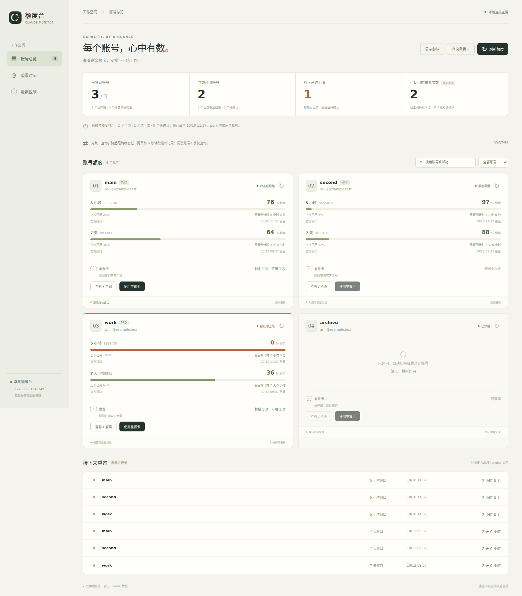

# Claude Auto

[中文](README.md) · [Configuration](docs/configuration.md) · [Security](SECURITY.md)

A local account launcher and quota dashboard for Claude Code. After a confirmed subscription quota error, the launcher verifies a context checkpoint, switches to another eligible account, and resumes the original session ID. The dashboard shows five-hour / weekly usage, reset times, and limit-reset grants.

Independent community project. The official Claude Code client is neither bundled nor modified. Use only accounts you are authorized to access; provider limits, permissions, and terms still apply.

On Claude Code 2.1.287+, the compaction plugin records native outcomes without adding retries or idle compaction requests. Background precomputation is reported separately from foreground compaction. See [upgrading and limitations](docs/compaction.md).



*All accounts, email addresses, and usage values in this screenshot are fictional.*

## Install

Requires **Linux, Python 3.10+, system timezone data, the official Claude Code CLI, and an interactive terminal**. Runtime dependencies are all in the Python standard library. Automatic switching requires at least two distinct signed-in subscription accounts. Native Windows and macOS are unsupported; WSL has not been separately validated.

Install Claude Code using the [official instructions](https://code.claude.com/docs/en/setup), then:

```bash
git clone https://github.com/Kaixxrua/claude-auto.git
cd claude-auto
python3 scripts/install.py
export PATH="$HOME/.local/bin:$PATH"
claude-accounts init
claude-accounts setup 2
claude-accounts status
claude-auto
```

`main` uses your existing `~/.claude` directory. `second` gets its own login directory. The official browser login flow signs each account in; verify the identity during each authorization. Preferences, skills, plugins, and project histories are shared by symlink, so profiles are not security isolation boundaries. Credentials remain separate. Cookie import and API-key substitution are unsupported.

## Dashboard

```bash
claude-quota
# Open http://127.0.0.1:8794
```

The first collection queries each enabled account. Afterwards the dashboard follows local status-line observations; use Refresh for idle accounts. Unknown or expired data remains unconfirmed rather than being reported as available quota. Reset-card inventory is queried separately.

Optional systemd user service:

```bash
python3 scripts/install.py --systemd
systemctl --user daemon-reload
systemctl --user enable --now claude-quota-monitor.service
```

For remote access, keep the loopback binding and use an SSH tunnel:

```bash
ssh -N -L 8794:127.0.0.1:8794 user@your-server
```

The dashboard has no authentication layer. Anyone who can access it can read account metadata and operate reset cards. Do not expose it publicly. Email masking is cosmetic.

## Commands

```bash
claude-auto --account second -- --model opus
claude-accounts use second -- --model opus
claude-accounts add work
claude-accounts login work
claude-accounts disable main --reason "Temporarily unavailable"
claude-accounts enable main
claude-accounts recovery SESSION_ID
claude-accounts recover SESSION_ID --account second
```

Disabled accounts, duplicate identities, and accounts with known quota cooldowns are skipped. Fresh, complete official usage results can clear stale cooldowns and briefly prioritize a recovered account. If no successor is available, the launcher preserves the session and stops with exit code `75`, showing a recovery command.

## Recovery and compatibility

Before switching, the launcher drains active tools and verifies saved parent / subagent history. It preserves session and agent identifiers and permission restrictions. An incomplete checkpoint blocks switching. Failed agents and stale task records are reconciled; separately managed, hash-pinned watcher services can be registered as nonblocking.

The initial release was exercised with Claude Code **2.1.295** on Linux. CLI output, hooks, and internal state may change. This is an interactive tool, not a `--print` API wrapper. Native ephemeral features, such as Artifact comment monitors, may need to be restarted through the official client.

Reset-card support uses **undocumented Anthropic OAuth endpoints** and is experimental. The module reads an existing access token in memory only when requested, sends it to a fixed Anthropic origin, and never returns it to the browser or refreshes it itself. Redemption requires explicit confirmation and a durable one-shot record; an ambiguous result is never retried automatically. The launcher itself does not read credentials.

Only confirmed quota exhaustion triggers switching. Bans, safety refusals, generic network errors, and unknown errors do not trigger cross-account retries. The exact concurrent-login-refresh error gets at most two delayed retries; user typing or task progress cancels pending retries. With a proxy configured, `API_TIMEOUT_MS` defaults to `60000` unless explicitly set; direct connections are unchanged.

## Development

```bash
python3 -m unittest discover -s tests -v
python3 scripts/check_release.py
node --check dashboard/static/app.js
```

Tests use temporary profiles, fake upstream clients, real PTYs, and loopback HTTP. No real accounts, tokens, reset cards, or Anthropic requests are required. See [CONTRIBUTING.md](CONTRIBUTING.md); operational documentation and the UI are currently primarily Chinese.

Licensed under [Apache-2.0](LICENSE). See [NOTICE](NOTICE) for attribution and trademark information.
